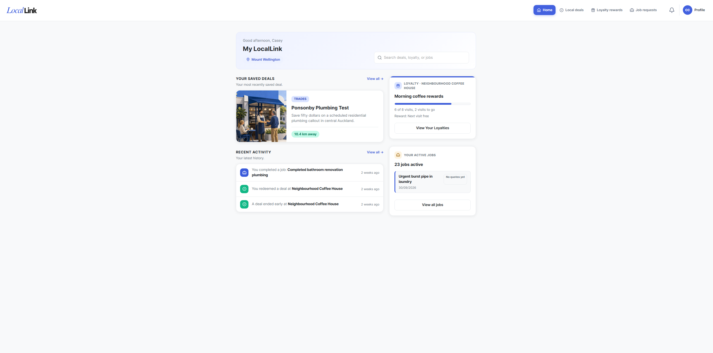
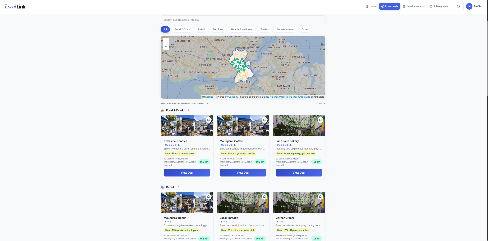
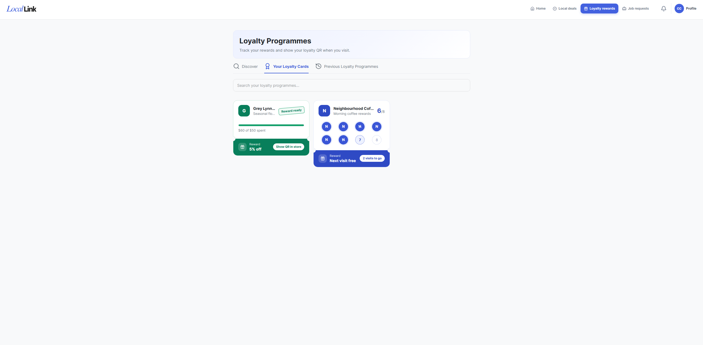
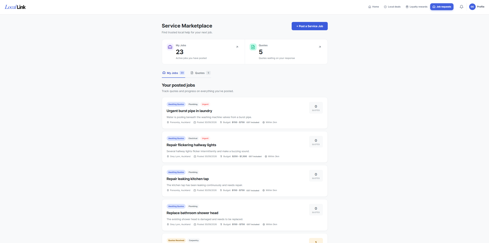
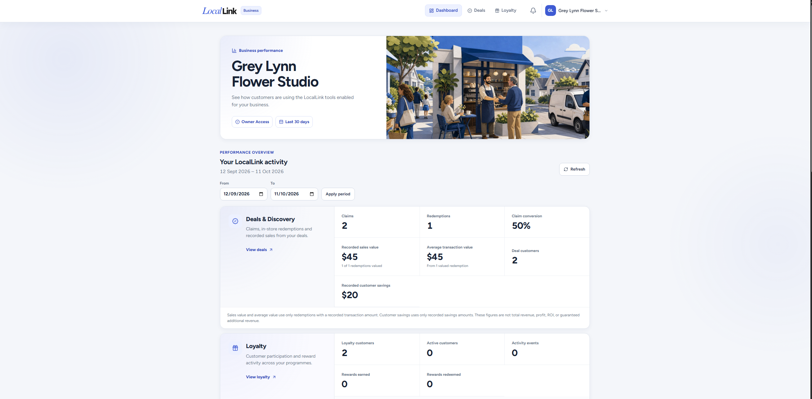
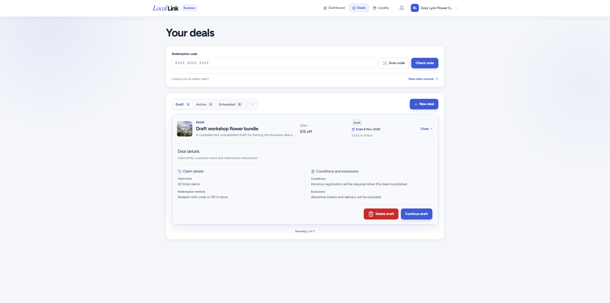
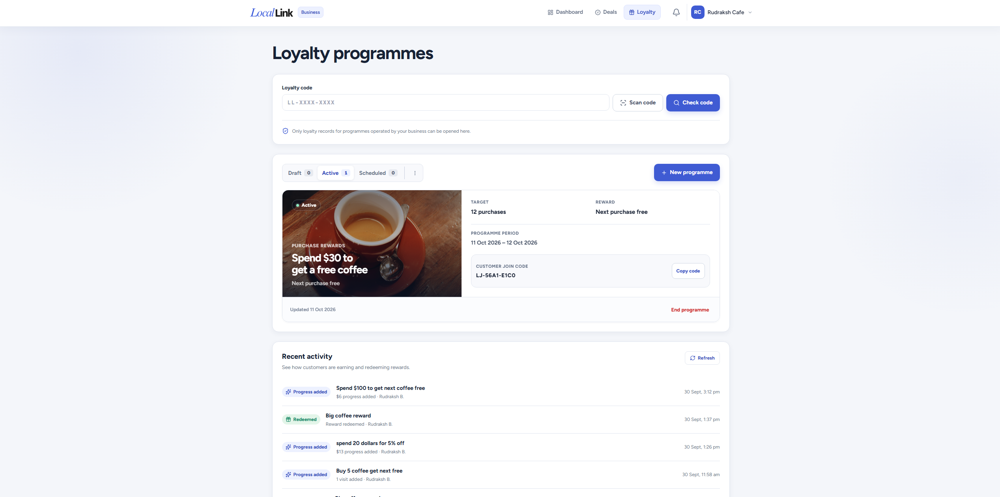
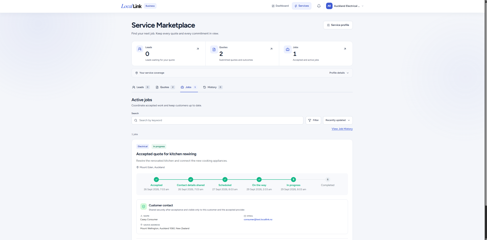
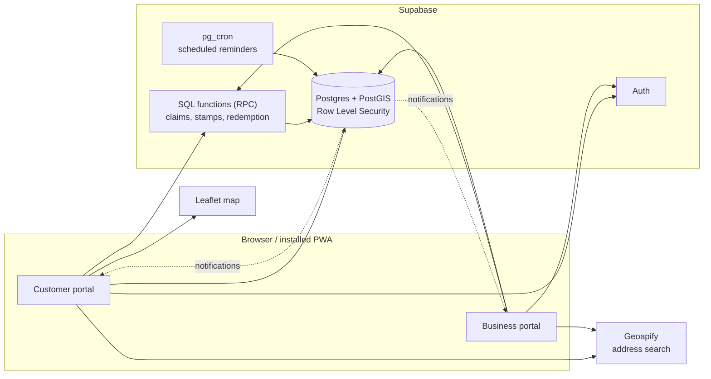

# LocalLink


[](https://github.com/v-spnz/locallink-capstone/actions/workflows/ci.yaml)

LocalLink connects local consumers with the local businesses around them. Customers discover local deals, collect loyalty rewards and request services from nearby tradespeople. Businesses publish offers, run loyalty programmes and respond to job leads from one portal.

> University Capstone project. Discovery is suburb-based and address search is limited to New Zealand.

## Screenshots

### Customer

| Home                                            | Deals                                             |
| ----------------------------------------------- | ------------------------------------------------- |
|  |  |

| Loyalty                                               | Services                                                |
| ----------------------------------------------------- | ------------------------------------------------------- |
|  |  |

### Business

| Dashboard                                                 | Deals                                             |
| --------------------------------------------------------- | ------------------------------------------------- |
|  |  |

| Loyalty                                               | Services                                                |
| ----------------------------------------------------- | ------------------------------------------------------- |
|  |  |

## Features

### Customer portal

- **Deals**: browse deals from nearby businesses (with search and a map), save them to a wallet, claim them with a QR code, and see claim history.
- **Loyalty**: discover programmes in your suburb, join (with confirmation), track progress, show a QR code for stamping, redeem rewards, and leave a programme.
- **Service marketplace**: post a job through a step-by-step wizard, receive quotes and follow accepted jobs.
- **Notifications**: reminders for loyalty rewards that are close, programmes ending soon and saved deals ending soon. Each notification opens the exact deal, loyalty card or job it refers to.
- **Profile**: account details, business access and an **All History** tab covering past jobs, deals and loyalty programmes.

### Business portal

- **Deals**: create, draft, publish and end deals, and review claim records.
- **Loyalty**: create programmes (purchase card, visit card, spend and save, spend and reward), look up a customer, add stamps or points, and redeem rewards.
- **Services**: manage service categories and areas, review job leads, submit quotes and track active jobs.
- **Dashboard and settings**: analytics and business profile management.

### Installable app (PWA)

LocalLink is a progressive web app. It has a web app manifest and icons, runs in standalone mode, and updates itself automatically when a new version is deployed. On a phone or desktop browser you can install it to the home screen or desktop and open it like a native app.

## Tech stack

| Area     | Technology                                                     |
| -------- | -------------------------------------------------------------- |
| Frontend | React 19, Vite 8, React Router 7, Tailwind CSS v4              |
| Maps     | Leaflet, Geoapify (address search)                             |
| Backend  | Supabase: Postgres, Auth, Row Level Security, PostGIS, pg_cron |
| Testing  | Node test runner (`node --test`), pgTAP                        |
| Tooling  | ESLint, Prettier, GitHub Actions                               |

## How it works



- **One app, two portals.** After signing in, a user lands in the customer portal. Business owners and staff also get the business portal for the businesses they belong to.
- **Suburb-based discovery.** Customers set their suburb, and deals, loyalty programmes and service requests are matched to that area. Location data is stored with PostGIS and shown on a Leaflet map.
- **Rules live in the database.** Row Level Security decides who can read or change each row. Actions such as claiming a deal, adding a loyalty stamp or redeeming a reward run as SQL functions, so the checks can't be skipped from the browser.
- **Loyalty in practice.** A customer joins a programme and shows a QR code at the counter. The business enters the code to look the customer up, adds a stamp or points, and redeems the reward when it's earned. The customer's card updates on its own.
- **Notifications.** Database triggers and scheduled `pg_cron` jobs create notifications, for example when a loyalty reward is close, a programme or saved deal is about to end, or a quote arrives. Each notification stores the page it should open.
- **Service marketplace.** Customers post a job, matching businesses see it as a lead and send quotes, and the customer accepts one to start the job.

## Getting started

### Prerequisites

- Node.js (a current LTS release)
- [Docker Desktop](https://www.docker.com/products/docker-desktop/) (needed for the local Supabase stack)
- The [Supabase CLI](https://supabase.com/docs/guides/cli) (`npx supabase` works too)
- A free [Geoapify](https://www.geoapify.com/) API key

### 1. Install dependencies

```bash
npm install
```

### 2. Configure environment variables

```bash
cp .env.example .env
```

| Variable                        | Purpose                            |
| ------------------------------- | ---------------------------------- |
| `VITE_SUPABASE_URL`             | Supabase project URL               |
| `VITE_SUPABASE_PUBLISHABLE_KEY` | Supabase publishable (anon) key    |
| `VITE_GEOAPIFY_API_KEY`         | Address autocomplete and geocoding |

Restrict your Geoapify key to the origins the app runs on (for example `http://localhost:5173`). Address search is limited to New Zealand. Never commit real keys.

### 3. Run against a local database

```bash
npx supabase start      # starts the local stack in Docker
npx supabase db reset   # applies all migrations and seed data
```

`supabase start` prints a local API URL and key. Put them in `.env.local`, which overrides `.env`:

```bash
VITE_SUPABASE_URL=
VITE_SUPABASE_PUBLISHABLE_KEY=
VITE_GEOAPIFY_API_KEY=
```

Use `npx supabase status` to see these values again. To point at a hosted Supabase project instead, leave `.env.local` out and put that project's values in `.env`.

### 4. Start the app

```bash
npm run dev
```

Open the URL Vite prints (normally http://localhost:5173).

### Demo accounts

After `npx supabase db reset`, these accounts exist in your **local** database only. They are created by `supabase/seed.sql` and are not real accounts. All of them use the password `LocalLink123!`.

| Role                           | Email                            | Notes                                                     |
| ------------------------------ | -------------------------------- | --------------------------------------------------------- |
| Customer                       | `consumer@test.locallink.nz`     | Casey Consumer: deals, loyalty and job posting            |
| Business owner (cafe)          | `cafe@test.locallink.nz`         | Neighbourhood Coffee House: deals and a loyalty programme |
| Business owner (florist)       | `florist@test.locallink.nz`      | Grey Lynn Flower Studio                                   |
| Business owner (plumber)       | `plumber@test.locallink.nz`      | Ponsonby Plumbing Test: service marketplace               |
| Business owner (electrician)   | `electrician@test.locallink.nz`  | Auckland Electrical Test: service marketplace             |
| Business owner (home services) | `homeservices@test.locallink.nz` | Harbour Home and Garden: service marketplace              |
| Customer                       | `member@test.locallink.nz`       | Mia Member                                                |
| Staff                          | `staff@test.locallink.nz`        | Sam Staff: admin of the plumber, staff at the cafe        |

Try the loyalty flow by signing in as the customer in one browser and the cafe owner in a private window, so you can show a card's QR code on one side and add a stamp on the other.

Seed data lives in `supabase/seed.sql` and `supabase/seeds/` (including a Mount Wellington demo dataset). Supabase Studio is available at http://127.0.0.1:54323 while the local stack is running.

## Testing and CI

GitHub Actions (`.github/workflows/ci.yaml`) runs on pull requests and on pushes to `main`:

- **detect_database_changes**: checks whether `supabase/`, `package.json`, `package-lock.json` or the workflow file changed.
- **quality-checks**: always runs. It runs lint, the Node tests and the build.
- **database-tests**: runs only when database-related files changed. It starts local Supabase, which applies the migrations, and runs the pgTAP suite.

A PR that only touches the frontend or the README skips the database tests. That is expected.

To check locally before opening a PR:

```bash
npm run lint
npm test
npm run build
npx supabase db reset && npm run test:db
```

## Project structure

```text
src/
  app/            App shell and routing
  auth/           Authentication context and guards
  business/       Business-side shared logic
  components/     Shared UI components (navigation, modals, ...)
  features/       Feature modules: deals, loyalty, location,
                  onboarding, service-marketplace, dashboard
  layouts/        Portal layouts
  lib/            Supabase client and helpers
  pages/          Route-level pages: auth/, customer/, business/
  utils/          Utilities
supabase/
  migrations/     Database schema, RLS policies, functions
  seed.sql        Base seed data
  seeds/          Extra demo datasets
  tests/database/ pgTAP tests
test/             Node unit tests
```

## Database conventions

- **Migration filenames** must be `<14-digit timestamp>_<name>.sql`, with an underscore straight after the timestamp. A space there makes the Supabase CLI silently skip the file. Migrations apply in numeric order, so give new ones a later timestamp than existing ones.
- **Row Level Security** needs both a policy and a table `GRANT` for the `authenticated` role. A missing grant shows up as a `403 permission denied`.
- **Notifications** store their destination when they are created. Changing a function does not rewrite existing rows.
- Add or update a pgTAP test in `supabase/tests/database/` with any database change.

## Contributing

1. Create a branch from `main`.
2. Make your change, adding tests where relevant.
3. Run lint, tests and the build locally (see above).
4. Open a pull request and wait for the CI checks to pass.

## Team

- Spencer Viernes: Project Manager
- Rudraksh Bansal: Lead Developer
- Justine Tayag: Scrum Master
- Shane Ashley Milo: Lead Researcher
